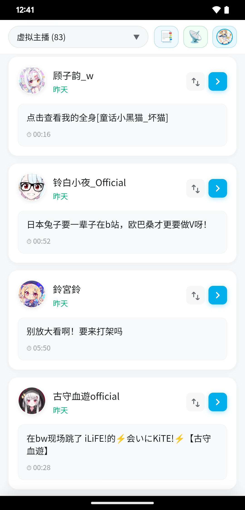
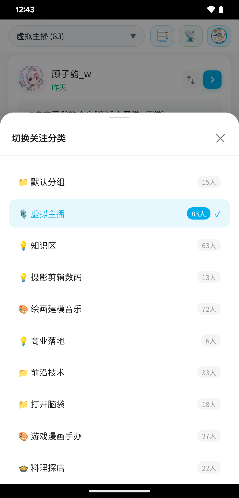
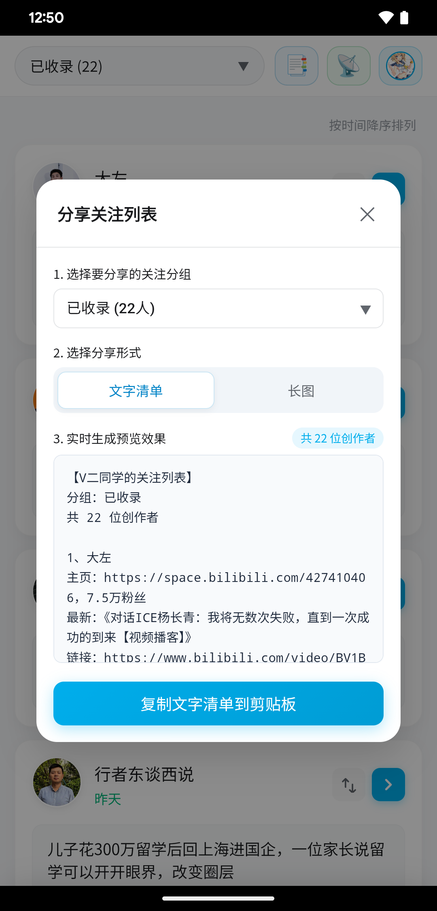
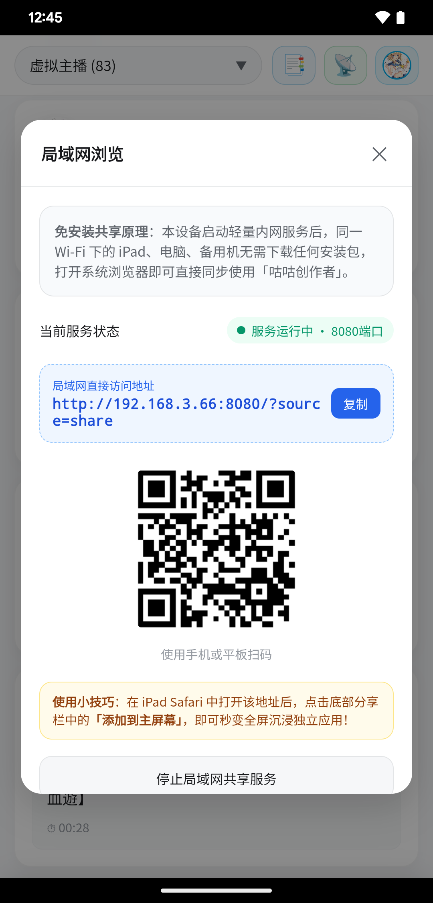

# 咕咕创作者 (Up Watcher)

**聚焦我所关注的**

为哔哩哔哩、YouTube 等视频平台的深度爱好者打造的关注追踪与时间线管理工具  
回归纯时间线，让小而美的创作者不再被淹没。

---

## 📖 产品初心

> “推荐算法能让我们看到全网的爆款，但也常常稀释了我们真正关心的声音。我们常常关注了许多小而美、更新频率不高的优质创作者，却因为平台的推荐流权重机制，错过了一期又一期的用心之作。
> 
> **咕咕创作者**的初衷并非替代官方客户端，而是作为一款纯粹的‘关注时间线放大镜’。我们不抢占播放，不内嵌广告，而是帮你把关注的创作者按时间倒序清晰陈列，一键唤醒官方客户端欣赏——把时间还给生活，把流量还给创作。”

---

## ✨ 核心特性

### 🕒 1. 绝对纯粹的发布时间线
* **零算法干预**：所有关注的 UP 主稿件按发布时间绝对倒序排列，新稿秒级感知。
* **清晰更新标记**：近 7 天更新醒目高亮，长期未更新创作者静默沉底，更新动态一览无余。
* **智能主播识别**：自动标注开播状态与直播动态，兼顾视频投稿与实时直播。

  

### 📱 2. 现代移动端与平板自适应架构
* **手机端 · 垂直优先抽屉**：告别难以滑动的横向标签，顶部点击即可呼出全屏抽屉，单手极速切换关注分组。
* **平板端 · 双模态自适应**：横屏支持大屏双列沉浸浏览；更支持分屏/侧拉悬浮小挂件，作为官方客户端伴侣随时查阅。
* **流畅原生手势**：记忆上次浏览位置与分组，离开返回无缝衔接。

  

### 📑 3. 精选关注书单与长图分享
* **纯文本清单导出**：一键将当前分组的 UP 主清单（含主页粉丝数、最近稿件发布时间）导出为规范 TXT，便于备份与交流。
* **高清推荐长图海报**：端内 Canvas 本地即时绘制，一键导出双列对称、排版优雅的分享长图，方便向好友安利宝藏 UP 主。

  

### 📡 4. 免安装局域网跨端浏览
* **多端免装即用**：手机端启动内置轻量服务，同一 Wi-Fi 下的 iPad、电脑或备用机无需安装任何 App，扫码即同步查阅。
* **极速互联**：支持一键将网页快捷方式添加到 iPad 主屏幕，秒变独立沉浸大屏伴侣。

  

### 🚀 5. 纯目录与客户端深度唤醒
* **100% 官方客户端唤醒**：点击创作者头像/昵称直达空间主页，点击作品卡片直接拉起客户端开启播放。
* **合规与版权尊重**：不包含任何视频解析与内嵌播放，完全尊重创作者收益与平台生态。

### 🔒 6. 纯本地私有运行，零隐私收集
* **无中心服务器**：所有数据均在您的本地设备上处理并离线持久化存储。
* **极速离线查看**：无网或弱网环境下依然可秒开查阅已同步的创作者列表与历史稿件。

---

## 📥 下载与安装

* **安装包下载**：请前往 [GitHub Releases](https://github.com/kinaito/up-watcher/releases) 下载最新发布的安装包 `gugu-creator-v1.0.14.apk`；
* **系统要求**：Android 8.0 及以上版本（支持主流安卓手机、折叠屏及平板电脑设备）。

> **安装提示**：若安装时系统提示“未知来源应用”，请在系统安全设置中允许安装来自该来源的应用。本应用不申请多余敏感权限（仅网络访问权限用于数据同步）。

---

## 🚀 快速上手

1. **登录与同步**：在设置弹窗中完成授权，系统将自动增量获取您的关注创作者与分组；
2. **分组切换**：点击顶部导航栏的当前分组名称，呼出底部抽屉快速筛选；
3. **空间与播放直达**：
   - 点击左侧 **头像/UP主名称**：调起官方客户端进入其个人空间；
   - 点击右侧 **视频标题/卡片**：直接在官方客户端秒开对应视频；
4. **生成分享**：点击顶部分享按钮，即可选择导出精选 TXT 书单或保存高清长图。

---

## ❓ 常见问题 (FAQ)

<b>Q1: 为什么点击视频没有在应用内直接播放？</b>

A: 这是我们坚定恪守的产品原则——咕咕创作者只做“轻量级导航目录与唤醒器”，不提供任何非官方播放器，所有播放、弹幕与点赞硬币等互动均在官方客户端内完成，全力支持正版创作生态。

<b>Q2: 我的账号信息和关注列表会被上传吗？</b>

A: 绝对不会。本应用采用无中心化服务器架构，数据直接与平台官方接口交互并加密保存在本地设备存储中，没有任何中间服务器收集或中转用户数据。

---

## 💬 交流与反馈

欢迎在公开仓库提交使用反馈与建议：

* **问题反馈 (Issues)**：[https://github.com/kinaito/up-watcher/issues](https://github.com/kinaito/up-watcher/issues)
* **代码仓库**：[https://github.com/kinaito/up-watcher](https://github.com/kinaito/up-watcher)
